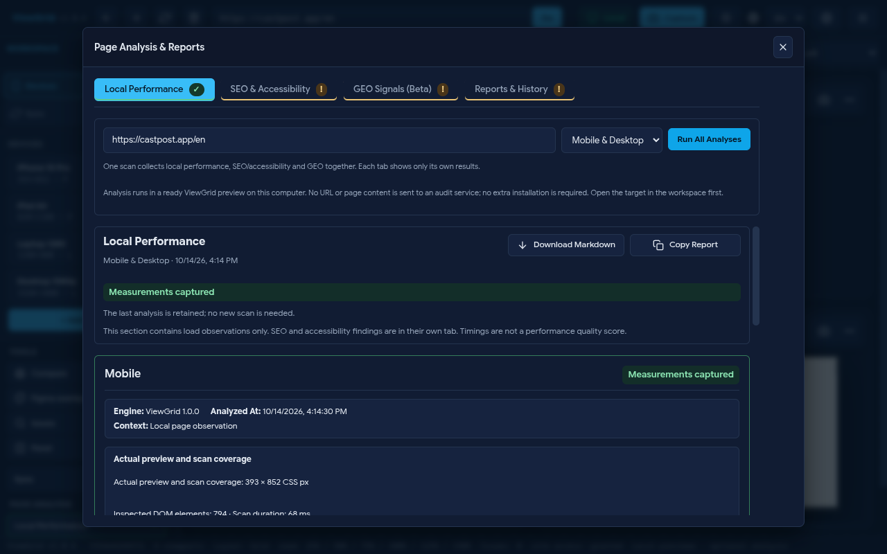
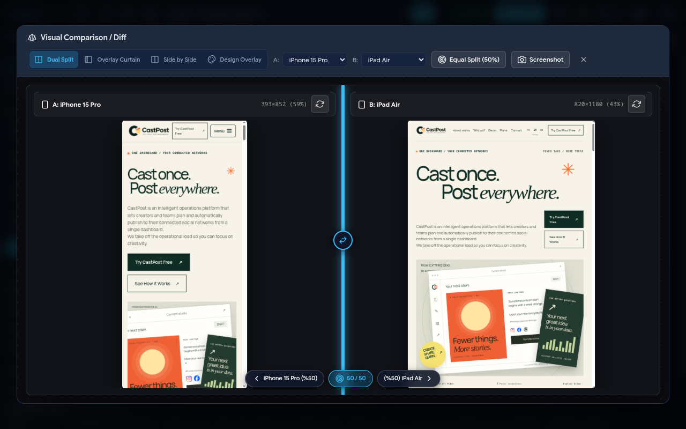

# ViewGrid · 1.0.4

[English](README.md) · [Türkçe](README.tr.md) · [Norsk bokmål](README.no.md)

[Website](https://viewgrid.sinansarikaya.dev/) · [Chrome Web Store](https://chromewebstore.google.com/detail/viewgrid-%E2%80%94-responsive-vie/hmlhooeamfmhdeichnghcklahfgimgef) · [Firefox Add-ons](https://addons.mozilla.org/en-US/firefox/addon/viewgrid-responsive-viewer/) · [Releases](https://github.com/sinansarikaya/viewgrid/releases)


**Yerel analiz**



**Görünümleri karşılaştırın**



**Telefon, tablet ve masaüstü düzenlerini tek sekmede yan yana test edin.** ViewGrid, Chromium ve Firefox için ücretsiz, açık kaynaklı bir tarayıcı eklentisidir. Arayüz ve raporlar Türkçe, İngilizce ve Norveççe Bokmål sunulur.

- 21 cihaz profili, 5 hazır set, özel boyutlar ve 16'ya kadar görünüm; grid, satır, sütun ve serbest yerleşim, sıralama, hizalama, odak, yön değiştirme ve merkezden zoom.
- Ayrı ayrı açılıp kapatılabilen kaydırma, tıklama, gezinme, yenileme, giriş/form ve tuş senkronizasyonu; yerel kayıtlı çalışma alanları ve ayarlar.
- Bölünmüş, perde ve yan yana karşılaştırma; dışa aktarılan PNG/SVG tasarım katmanı. Figma API entegrasyonu veya otomatik piksel farkı skoru değildir.
- Tek görünüm veya tüm genişletilmiş görünümler için PNG; büyük görünümlerde parçalı yakalama, 32 megapiksel sınırı ve Escape ile iptal. Çalışma alanı görüntüsü görünür alanı yakalar; tam sayfa belgesi değildir.
- Duyarlı tasarım sorunlarında gruplu bulgular, cihaz/ölçüm/selector kanıtı, filtre ve öğe vurgulama; Markdown kopyalama, JSON ve yazdırılabilir HTML raporları. Benzersiz bulgu ve cihaz tekrarları ayrı gösterilir; isteğe bağlı ergonomi önerileri ayrı tutulur.
- **Eklentiye paketlenen yerel analiz:** mobil, masaüstü veya varsayılan olarak ikisi; yükleme gözlemleri, DOM tabanlı SEO, axe erişilebilirlik kontrolleri ve deneysel GEO sinyalleri. Her bölüm kendi Markdown kopyalama/indirmesini sunar. Sonuçlar oturumda korunur, hedef değişince eski olarak işaretlenir; kapsam ve başarısız kontroller görünürdür.
- Yumuşak panel/menü geçişleri, azaltılmış hareket desteği ve dış tık/Escape ile kapanan menüler.

**Kurulum:** Güncel Chromium/Firefox ZIP'ini ve `SHA256SUMS` dosyasını Releases'ten alın. Chromium'da ZIP'i açın, `chrome://extensions` → Geliştirici modu → Paketlenmemiş öğe yükle. Firefox'ta `about:debugging#/runtime/this-firefox` → Geçici eklenti yükle → `manifest.json`; yeniden başlatınca kaldırılır. Kalıcı Firefox kurulumu için imzalı AMO paketini kullanın. Kaynak pakette doğru klasörler `dist/chromium` ve `dist/firefox` olur. GitHub paketleri ile mağaza incelemesi ayrıdır; mağazalardaki mevcut 1.0.3 sürümü yeni 1.0.4 incelemesi/yayını tamamlanana kadar kalabilir.

**Sınırlar ve güvenlik:** Analiz için harici API, Google/CrUX isteği, hesap veya ek motor kurulumu gerekmez. Yerel gözlemler Lighthouse skoru veya gerçek kullanıcı Core Web Vitals verisi değildir; tam site crawl, DAST ve uygunluk sertifikası sunulmaz. GEO sinyalleri sıralama veya yapay zekâ görünürlüğü garantisi değildir. Sıfır bulgu uygunluğu kanıtlamaz; tarama limitleri, gölge DOM ve iç içe çapraz origin çerçeveler kapsama engeli olabilir.

Giriş/form/tuş senkronizasyonu aynı origin ile sınırlandırılır. Tür, autocomplete ve ad/ID üzerinden tanınan parola, tek kullanımlık kod ve ödeme alanlarında yakalama ve uygulama engellenir. Önizleme bağlantısı gerçek üst çalışma alanı, doğrudan iframe kimliği ve doğrulanmış frame/document kaydıyla kontrol edilir; sayfanın kendi oluşturduğu mesajlar bağlantı kanıtı sayılmaz.

Eklentide telemetri ve bulut proxy yoktur; seçtiğiniz siteler olağan ağ isteklerini yapar. Çerçeveleme istisnaları doğrulanmış çalışma alanı sekmeleriyle sınırlıdır: Firefox doğrudan önizlemede XFO ve CSP `frame-ancestors` kaldırır; Chromium çalışma alanının iç içe çerçeveleri dahil alt çerçevelerinde XFO ve tüm CSP yanıt başlıklarını kaldırır. Normal sekmelerin çerçeveleme korumaları korunur. Önizleme yüklenmeden seçili sitenin service worker kayıtları origin (Chromium) veya hostname (Firefox) kapsamıyla kaldırılır; bu aynı sitenin normal sekmelerdeki worker'larını da etkileyebilir. Cookie, localStorage, sessionStorage, IndexedDB ve CacheStorage silinmesi istenmez. İzin, oturum açma, üçüncü taraf cookie ve sandbox kısıtları önizlemeyi engelleyebilir. Profiller CSS görünüm boyutu sağlar; gerçek mobil donanım, DPR veya tarayıcı motoru emülasyonu değildir. Sabit RAM/FPS/gecikme garantisi yoktur.

## Geliştirme

```bash
pnpm install --frozen-lockfile
pnpm run lint
pnpm run typecheck
pnpm run typecheck:website
pnpm test
pnpm run build:all
pnpm run lint:web-ext
pnpm exec playwright install --with-deps chromium
pnpm run test:e2e
pnpm run build:website
pnpm run package:release
```

[Sürüm notları](docs/RELEASE_NOTES_1.0.4.md) · [Değişiklik günlüğü](CHANGELOG.md) · [Gizlilik](docs/PRIVACY.md) · [Güvenlik](SECURITY.md) · [Testler](docs/TESTING.md) · [MIT Lisansı](LICENSE)

[Sinan Sarıkaya](https://github.com/sinansarikaya) · [Destekleyin](https://github.com/sponsors/sinansarikaya)
